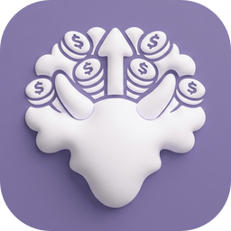
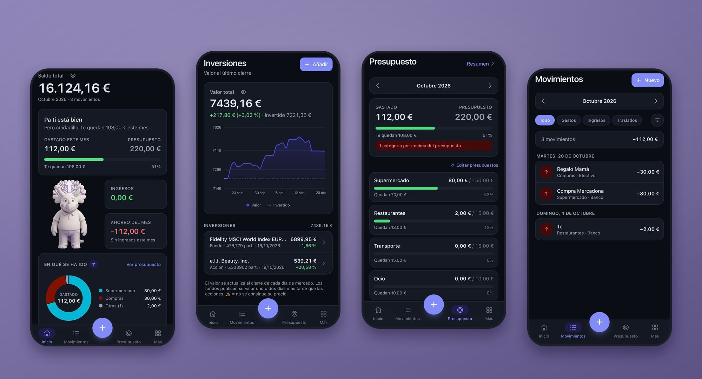
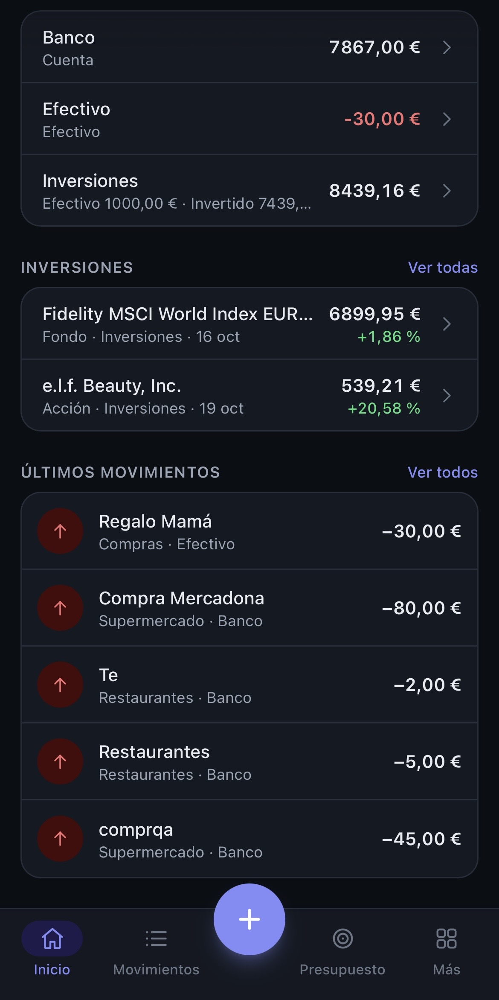
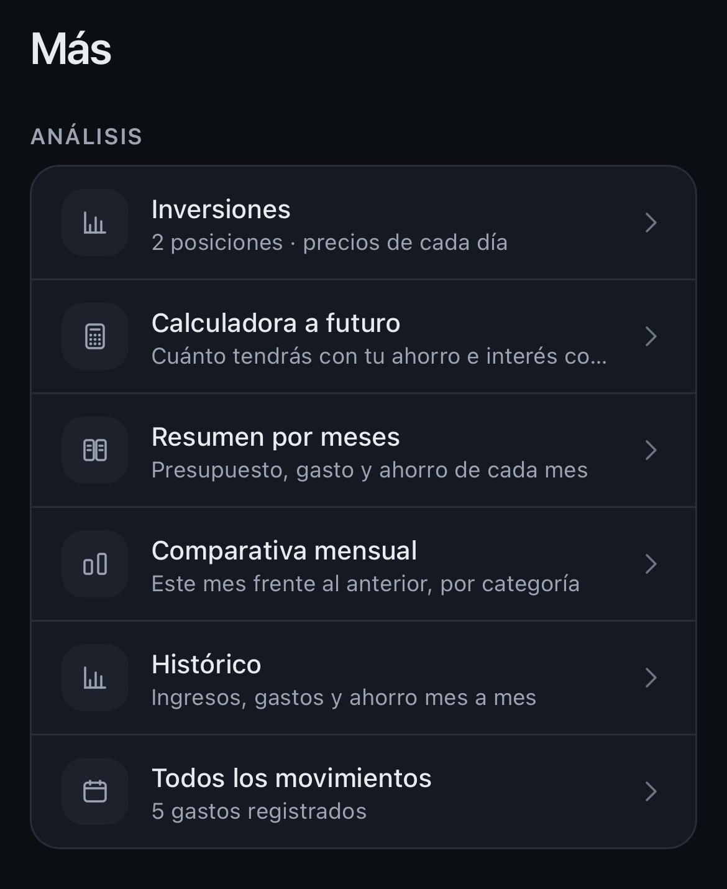
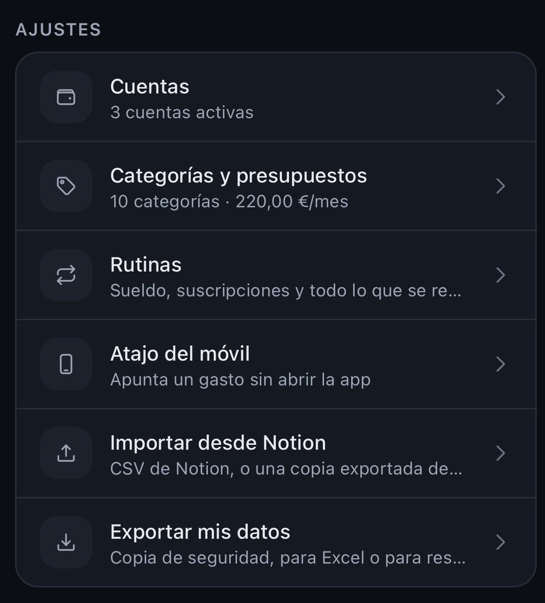
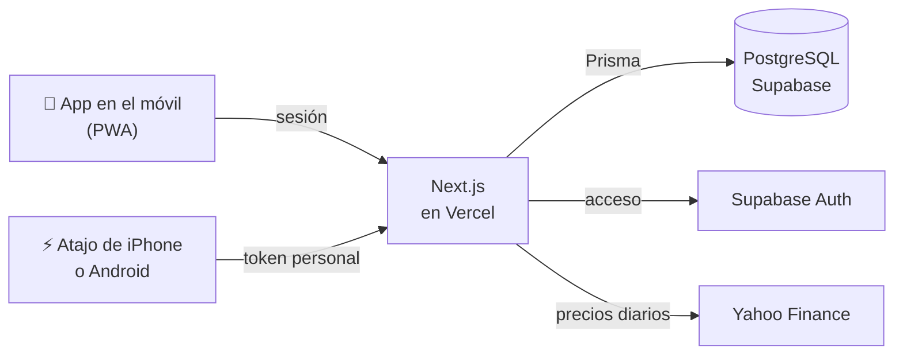

<div align="center">



# Horn Capital

**Aplicación para finanzas personales.**<br>
*Lleva el control de tus finanzas en segundos.*


</div>

<p align="center">
  
</p>

<details>
<summary><b>Más capturas</b></summary>
<br>
<p align="center">
  
  
  
</p>
</details>

## La idea

Horn Capital nació para sustituir un sistema de finanzas montado en Notion, que
era potente pero lento de usar desde el móvil. Es una app web que se instala en
el teléfono o en el pc como una app más (PWA).

> 🔑 **¿Quieres probarla?** El acceso es por invitación: escríbeme a
> [xpatinom@gmail.com](mailto:xpatinom@gmail.com?subject=Cuenta%20en%20Horn%20Capital).

## Qué hace

| | |
|---|---|
| 💸 **Movimientos** | Gastos, ingresos y traslados entre cuentas.|
| 🎯 **Presupuesto** | Presupuesto mensual por categoría, con lo que queda en cada una. |
| 📊 **Análisis** | Reparto del gasto por categoría o por cuenta, comparativa con el mes anterior, histórico y resumen mes a mes. |
| 🔁 **Rutinas** | Suscripciones, sueldo o alquiler que se repiten (semanal, mensual, trimestral o anual). Se apuntan solas o piden confirmación. |
| 📈 **Inversiones** | Fondos, ETFs y acciones buscados por ISIN, con su precio de cada día. El patrimonio total incluye lo que valen hoy. |
| ⚡ **Atajo del móvil** | Apunta un gasto **sin abrir la app**, desde Atajos de iPhone o HTTP Shortcuts en Android. |
| 🧮 **Calculadora a futuro** | Cuánto tendrás si sigues ahorrando a tu ritmo, con interés compuesto. |
| 👁️ **Modo privado** | Difumina los saldos para enseñar la app sin enseñar tu dinero. |
| 📦 **Tus datos son tuyos** | Importación en CSV y copia de seguridad. |

## La mascota

Un triceratops en la pantalla de inicio te dice cómo vas con el presupuesto del mes.

<table align="center">
  <tr>
    <td align="center"></td>
    <td align="center"></td>
    <td align="center"></td>
  </tr>
  <tr>
    <td align="center"><b>Rico</b><br><sub>Te queda el 62,5 % o más</sub></td>
    <td align="center"><b>Normal</b><br><sub>Te queda entre el 25 % y el 62,5 %</sub></td>
    <td align="center"><b>Vagabundo</b><br><sub>Te queda menos del 25 % o te has pasado</sub></td>
  </tr>
</table>

## Cómo funciona



- **Todo se calcula en el servidor.** Las pantallas son Server Components y lo
  que escribe en la base son Server Actions, así que el móvil recibe la página
  ya hecha.
- **El saldo nunca se guarda, se calcula.** Sale siempre de los movimientos, así
  que es imposible que se descuadre. Si no coincide con el banco, un ajuste de
  saldo lo corrige sin contar como ingreso ni gasto.
- **Cada persona ve solo lo suyo.** Todas las consultas filtran por el usuario
  de la sesión (nunca por algo que mande el navegador), la base tiene Row Level
  Security en todas las tablas y un script revisa que ninguna consulta se deje
  el filtro.
- **El atajo del móvil va con un token personal**, que solo sirve para apuntar
  gastos y se puede revocar. En la base solo se guarda su huella, nunca el token.
- **Las fechas son días, no instantes**: un gasto es "del 5 de agosto" esté
  donde esté el móvil.

## Stack

| | |
|---|---|
| **Framework** | Next.js 16 (App Router) con TypeScript |
| **Estilos** | Tailwind CSS 4, con tema claro y oscuro |
| **Datos** | PostgreSQL en Supabase, con Prisma 6 |
| **Acceso** | Supabase Auth |
| **Gráficas** | Recharts |
| **Móvil** | PWA con service worker propio, sin dependencias |
| **Despliegue** | Vercel |

## Ponerla en marcha

<details>
<summary>Instalación en local con tu propio proyecto de Supabase</summary>
<br>

Necesitas Node.js y un proyecto de [Supabase](https://supabase.com) (el plan gratuito sirve).

```bash
npm install
cp .env.example .env         # rellénalo con los datos de tu proyecto de Supabase
npx prisma migrate deploy    # crea las tablas, con su seguridad
npm run dev                  # http://localhost:3000
```

Crea tu usuario en Supabase (*Authentication → Users*). La primera vez que entres,
la app te prepara categorías y cuentas de partida.

```bash
npm run typecheck             # tipos
npm run auditar               # ninguna consulta sin filtro por usuario
npm run probar:aislamiento    # un usuario no ve los datos de otro
```

</details>

## Estructura

<details>
<summary>Cómo está organizado el código</summary>
<br>

```
src/
  app/          Pantallas (App Router)
  actions/      Server Actions: todo lo que escribe en la base
  lib/          Lógica: saldos, presupuestos, rutinas, inversiones, precios
  components/   Interfaz y gráficas
prisma/         Modelo de datos y migraciones
scripts/        Diagnóstico, auditoría y pruebas
```

</details>

<div align="center">
<sub>Proyecto personal de <a href="https://github.com/XesusPatino">@XesusPatino</a></sub>
</div>
